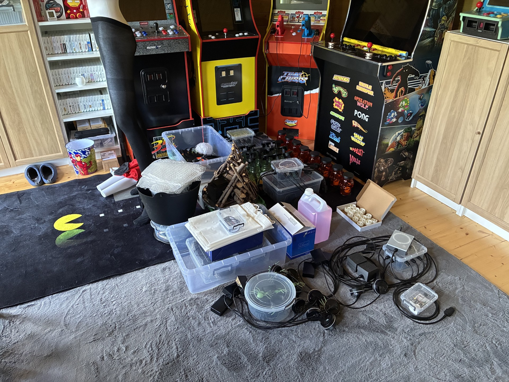
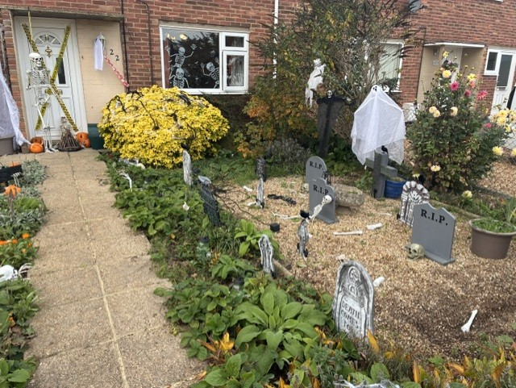
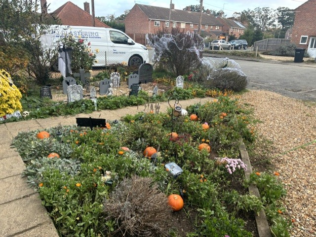
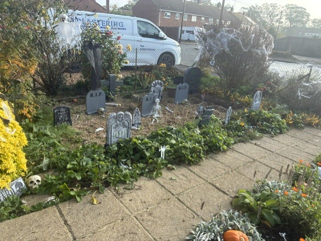
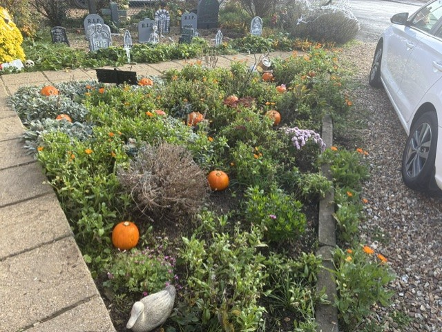
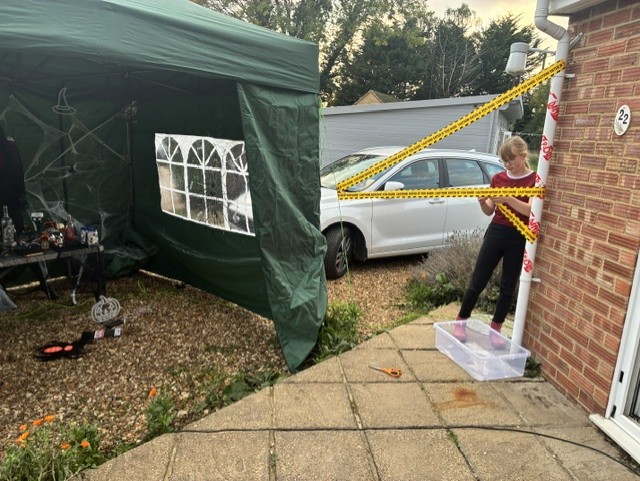
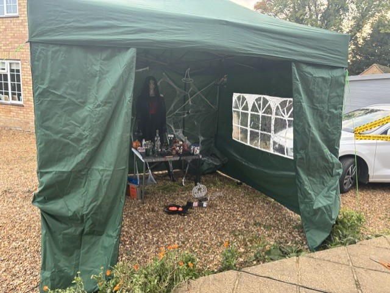

# Overview of 2026

This year, Halloween is on a Saturday so I don't need to take
any time off work. It does mean I need to start preparations
the week before though (although my daughter actually started
putting the graveyard together at the beginning of October)!

## The week before, Sunday 25th October

Locating all the key electronics and grouping them together was
the primary task today, along with getting Hazel out and fitting
her together. These are all in the cabin ready to be put outside.

## The big day, Saturday 31st October

A few pictures of my daughter and I setting up. The images are of the
Graveyard, pumpkin patch and witches house.

